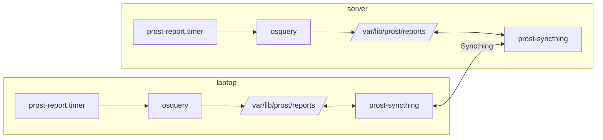

# 🍻 Prost for NixOS

Hourly [osquery](https://osquery.io/) reports about each of your devices,
shared between all of them over a dedicated [Syncthing](https://syncthing.net/)
instance. A NixOS reimplementation of the idea behind
[khaffner/prost](https://github.com/khaffner/prost): no server, no accounts,
just Syncthing between your own machines.

The `prost` folder drops into your NixOS config. Once an
hour it runs a set of osquery queries and writes `<hostname>.json` into
`/var/lib/prost/reports`. A Syncthing instance that belongs to Prost alone
syncs that folder with every other device, so each device holds every
device's latest report. `prost overview` prints them as a table. `/var/lib/prost/overview.html` is the same
overview as a web page, regenerated automatically whenever any device's report
changes, so opening that file in a browser always shows the current state of
the whole fleet.

Which devices are paired is **not** in the Nix config, so the config can live
in a public repo. Pairing is done once per device with `sudo prost add-device`
and stored under `/var/lib/prost`, where it survives rebuilds.



## Install

Copy the `prost` folder next to your `configuration.nix` and import
`prost/prost.nix`. If several hosts share a common module, import it from there
so every host gets it.

```sh
git clone https://github.com/khaffner/nixos-prost /tmp/nixos-prost
sudo cp -r /tmp/nixos-prost/prost /etc/nixos/prost
```

```nix
# configuration.nix, or a module that all hosts import
{
  imports = [ ./prost/prost.nix ];
}
```

Then `sudo nixos-rebuild switch`. The module is active as soon as it is
imported and needs no further configuration. An existing `services.syncthing`
is untouched because Prost runs its own instance on its own ports (see below).

## Pairing devices

Device IDs are shown by `sudo prost device-id`. The first time, pair two
devices with each other:

```sh
# on the laptop
sudo prost add-device server <the server's device ID>
# on the server
sudo prost add-device laptop <the laptop's device ID>
```

Every paired device is marked as a Syncthing *introducer*, so from then on
a new device only has to be paired with one existing device, in both
directions. The rest of the group learns about it automatically.

```sh
sudo prost status           # folder state, who is online, sync progress
sudo prost remove-device laptop  # unpair
```

Devices find each other through Syncthing's global discovery and relays, so
no ports need to be opened. For direct LAN connections set
`services.prost.syncthing.openFirewall = true;`.

## Commands

| Command | What it does |
|---|---|
| `prost overview` | Terminal table of every device's latest report |
| `prost html [FILE]` | Self-contained HTML overview of all devices, default `/var/lib/prost/overview.html` |
| `sudo prost report` | Generate this device's report now instead of waiting for the timer |
| `sudo prost device-id` | This device's Syncthing ID |
| `sudo prost add-device NAME ID` | Pair with another Prost device |
| `sudo prost remove-device NAME` | Unpair |
| `sudo prost status` | Syncthing status: folder state, per device connected, address, last seen, sync completion |
| `sudo prost syncthing ...` | `syncthing cli` against the Prost instance, e.g. `show connections` |

## The aggregated overview

Every device holds every report, so every device can build the full picture.
A systemd path unit watches `/var/lib/prost/reports` and runs `prost html`
whenever a file there changes, which keeps `/var/lib/prost/overview.html`
current on every machine. The page is a single file with no external assets:
a summary table (age, OS, kernel, uptime, load, memory, root disk, battery,
IPv4 addresses, listening ports) with stale devices and high usage
highlighted, plus each device's raw report in a collapsible section.

```sh
xdg-open /var/lib/prost/overview.html
prost html ~/fleet.html   # or write it somewhere else
```

The overview file is deliberately outside the synced folder: each machine
generates its own copy, so there is nothing to conflict on.

Reports are plain JSON in `/var/lib/prost/reports/`, readable by any user:

```sh
jq '.queries.listening_ports' /var/lib/prost/reports/server.json
```

## Options

Everything has a default; set these only to change something.

| Option | Default | Meaning |
|---|---|---|
| `services.prost.enable` | `true` | Set to `false` on a host that should not run Prost |
| `services.prost.name` | `networking.hostName` | This device's name, used as the report filename |
| `services.prost.interval` | `"hourly"` | systemd `OnCalendar` expression for the report timer |
| `services.prost.queries` | built-ins | osquery SQL by name, merged with the built-in set. `null` removes a built-in |
| `services.prost.syncthing.port` | `22001` | Sync port. Not 22000, so it does not clash with a regular Syncthing |
| `services.prost.syncthing.discoveryPort` | `21028` | LAN discovery port. Not 21027, for the same reason |
| `services.prost.syncthing.openFirewall` | `false` | Open the two ports above |
| `services.prost.osqueryPackage` | `pkgs.osquery` | |
| `services.prost.syncthingPackage` | `pkgs.syncthing` | |

### Built-in queries

`osquery`, `system_info`, `os_version`, `kernel`, `uptime`, `load_average`,
`memory`, `disks`, `interfaces`, `listening_ports`, `battery`. See
`prost/queries.nix` for the SQL. Add your own or drop one:

```nix
services.prost.queries = {
  users = "SELECT username, uid, shell FROM users WHERE uid >= 1000;";
  battery = null;
};
```

A query that fails is recorded as `null` in the report and logged; the rest
of the report is still written.

### Report format

```json
{
  "name": "laptop",
  "hostname": "laptop",
  "generatedAt": "2026-10-21T10:00:00Z",
  "queries": {
    "os_version": [ { "name": "NixOS", "version": "26.05 (Xantusia)", "platform": "nixos", "arch": "x86_64" } ],
    "uptime": [ { "days": "3", "hours": "4", "minutes": "5", "total_seconds": "274000" } ],
    "...": "..."
  }
}
```

osquery returns every value as a string, so numbers in reports are strings too.

## How it stays out of the way of your existing Syncthing

Everything lives under `/var/lib/prost` and runs as root:

| | Prost instance | Regular `services.syncthing` |
|---|---|---|
| Home | `/var/lib/prost/syncthing` | `~/.config/syncthing` |
| Sync port | 22001 | 22000 |
| LAN discovery port | 21028 | 21027 |
| GUI / REST API | unix socket `/var/lib/prost/syncthing/gui.sock`, root only | `127.0.0.1:8384` |

The GUI is deliberately not on a TCP port: a root-owned Syncthing reachable
by any local user would let that user add folders anywhere on disk. Use
`sudo prost ...` instead of a web UI.

On every boot and rebuild the `prost-syncthing-init` service pushes the
Nix-managed settings (ports, the shared folder) into the running instance
through its REST API, the same way the upstream NixOS Syncthing module does.
It never touches the paired devices.

## Troubleshooting

```sh
systemctl status prost-report.timer prost-overview.path prost-syncthing prost-syncthing-init
journalctl -u prost-syncthing-init -u prost-syncthing
sudo prost status
```

Starting over on one device: `sudo systemctl stop prost-syncthing`, remove
`/var/lib/prost/syncthing`, start it again, and re-pair. The device gets a
new ID.

## Design notes

- All paired devices are trusted peers: the shared folder is send-and-receive
  everywhere and every peer is an introducer, so any device can overwrite any
  report or introduce new devices. Same trust model as the original Prost.
- No script pushing. Prost for NixOS only collects reports; what runs on a
  device is whatever its NixOS configuration says. Since every
  paired device can write to the synced folder, executing anything found there
  would give each device root on all the others.
- Backup-worthy state: only `/var/lib/prost/syncthing` (identity and pairings).

## Layout

| File | Contents |
|---|---|
| `prost/prost.nix` | Entry point, imports the files below |
| `prost/options.nix` | `services.prost.*` options |
| `prost/queries.nix` | Built-in osquery queries |
| `prost/cli.nix` | Builds the `prost` command from `prost.sh` |
| `prost/prost.sh`, `prost/api.sh` | The command's shell script, and the Syncthing REST helpers it shares with the init service |
| `prost/report.nix` | Report timer and the HTML overview path watcher |
| `prost/syncthing.nix` | The dedicated Syncthing instance and its init service |
| `prost/common.nix` | Paths and the REST API helper shared by the above |
| `prost/jq/` | jq programs for the terminal and HTML overviews |
